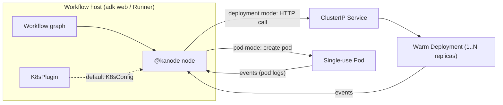
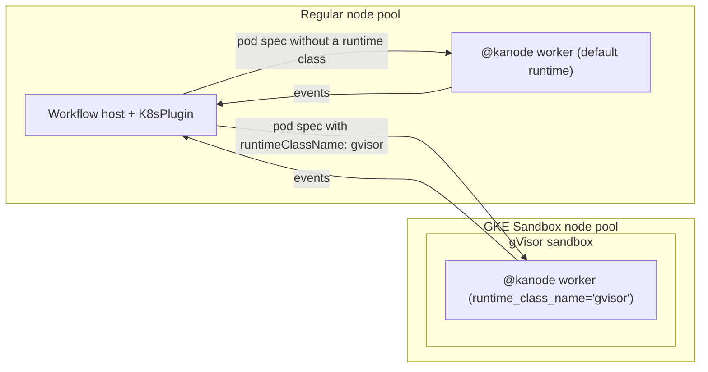

<div align="center">

# adk-kanode

**Run Google ADK Workflow nodes in their own Kubernetes pods with a single decorator.**

[](https://github.com/benmizrahi/adk-kanode/actions/workflows/tests.yml)
[](https://www.python.org/)
[](https://google.github.io/adk-docs/)
[](https://kubernetes.io/)
[](https://github.com/benmizrahi/adk-kanode/blob/main/LICENSE)

</div>

`adk-kanode` is a Python library for the
[Google Agent Development Kit (ADK)](https://google.github.io/adk-docs/): a Workflow
plugin and node decorator (`@kanode` / `@k8s_node`) for running AI agent workflow
nodes on Kubernetes. It extracts a node's implementation and executes it inside a
dedicated GKE / Kubernetes workload, while the workflow graph itself stays plain ADK.

```python
@kanode
def analyze(node_input: list[str]) -> Event:
    """Runs in its own pod."""
    return Event(output={"lines": len(node_input)})
```

## Contents

- [Why adk-kanode](#why-adk-kanode)
- [Features](#features)
- [How it works](#how-it-works)
- [Installation](#installation)
- [Quick start](#quick-start)
- [Execution modes](#execution-modes)
- [Configuration](#configuration)
- [Sandboxing nodes with GKE Sandbox](#sandboxing-nodes-with-gke-sandbox)
- [Running without a cluster](#running-without-a-cluster)
- [Examples](#examples)
- [Development](#development)
- [Contributing](#contributing)
- [License](#license)
- [Disclaimer](#disclaimer)

## Why adk-kanode

By default every node of an ADK Workflow runs in the same process as the workflow
host. `adk-kanode` lets you move individual nodes onto Kubernetes without changing
the graph:

- **Per-node resources**: give a heavy node its own CPU / memory limits, container
  image, node selector and replica count.
- **Per-node credentials**: attach a ServiceAccount and Kubernetes Secrets to just
  the node that needs them.
- **Isolation**: run a node in a fresh single-use pod per call (`mode="pod"`), and
  optionally inside [GKE Sandbox](#sandboxing-nodes-with-gke-sandbox) (gVisor).
- **No extra packaging**: no per-node images or entrypoint scripts; the node's
  source is shipped to a generic worker image.

## Features

- **Drop-in ADK Workflow Node (`K8sNode` / `KaNode`)**: Inherits from `google.adk.workflow.Node` (`BaseNode`), so `@kanode`-decorated nodes work anywhere in `Workflow(edges=[...])` — sequential chains, conditional routing maps, fan-out tuples, `JoinNode` fan-in, and `parallel_worker=True`.
- **Accepts Any ADK `NodeLike`**: Wrap sync/async functions, generators, `LlmAgent`, `BaseAgent`, `BaseTool` / `FunctionTool`, or custom `BaseNode` subclasses.
- **Automatic Implementation Extraction**: Inspects the wrapped function/node AST, strips the `@kanode` decorator so the pod runs the raw implementation, extracts module imports and Pydantic schemas, and runs the node inside a dedicated GKE pod via `python3 -u -c` without requiring manual entrypoint scripts.
- **ADK `K8sPlugin` (`BasePlugin`)**: Provides cluster-level default `K8sConfig` (configured via `ADK_K8S_*` environment variables or kwargs) and automatic pod cleanup on workflow completion or failure.

## How it works



1. `@kanode` wraps the node and extracts its source, imports and Pydantic schemas.
2. When the workflow reaches the node, the input is sent to a worker in the cluster.
3. The worker runs the original implementation and returns its ADK events to the workflow.

For the full technical details (source extraction, the worker protocol, rolling
updates and the security model), see [docs/ARCHITECTURE.md](https://github.com/benmizrahi/adk-kanode/blob/main/docs/ARCHITECTURE.md).

## Installation

Requires Python 3.12+.

```bash
pip install "git+https://github.com/benmizrahi/adk-kanode.git"
```

Or with [uv](https://docs.astral.sh/uv/):

```bash
uv add "git+https://github.com/benmizrahi/adk-kanode.git"
```

## Quick start

```python
from google.adk.apps import App
from google.adk.events.event import Event
from google.adk.workflow import Workflow
from adk_kanode import K8sPlugin, kanode


@kanode
def task_C_node(node_input: str):
    """A FunctionNode to execute node C in a dedicated GKE pod."""
    return Event(output=f"Task C completed: {node_input}")


workflow = Workflow(
    name="my_gke_workflow",
    edges=[
        ("START", task_C_node),
    ],
)

app = App(
    name="my_app",
    root_agent=workflow,
    plugins=[K8sPlugin()],
)
```

## Execution modes

| Mode | What runs | Per-call latency | Use for |
| --- | --- | --- | --- |
| `deployment` (default) | One warm `Deployment` + `ClusterIP Service` per `@kanode` | one in-cluster HTTP call | Normal nodes |
| `pod` | A fresh pod per call, deleted afterwards | pod scheduling + Python startup | Strict one-shot isolation |

Set it globally with `ADK_K8S_MODE` / `K8sPlugin(mode=...)`, or per node:

```python
@kanode(replicas=3)   # warm Deployment with 3 replicas
def hot_node(node_input: str): ...

@kanode(mode="pod")   # fresh single-use pod per call
def isolated_node(node_input: str): ...
```

In deployment mode:

- Deployments are created on a node's first call. Call `plugin.prewarm(root_agent)`
  when the app loads to start them before the first request.
- Changing a node's code or config updates its Deployment with a rolling update.
- Deployments stay running when the app stops. Remove them with
  `kubectl delete deploy,svc -l app.kubernetes.io/managed-by=adk-kanode`.
- The workflow host must run inside the cluster; otherwise nodes fall back to `pod` mode.
- The host needs RBAC for `deployments`, `services` and the `adk-kanode-worker-token`
  Secret (the bearer token workers require). See `examples/k8s.yaml`.
- A worker process is shared by concurrent calls. A node that blocks on CPU-heavy
  synchronous code delays other calls on that replica; raise `replicas` for those.

## Configuration

Settings resolve in this order: `@kanode(...)` arguments, then `K8sPlugin(...)`
arguments, then environment variables, then the built-in default.

```python
K8sPlugin(image="us-docker.pkg.dev/my-proj/adk/worker:latest", namespace="agents")

@kanode(memory_limit="1Gi", secret_env={"API_KEY": ("my-secret", "api-key")})
def call_api(node_input: str): ...
```

| Option | Environment variable | Default | Description |
| --- | --- | --- | --- |
| `image` | `ADK_K8S_IMAGE` | `python:3.12-slim` | Container image that runs the node |
| `namespace` | `ADK_K8S_NAMESPACE` | `default` | Namespace for workers |
| `service_account_name` | `ADK_K8S_SERVICE_ACCOUNT` | – | ServiceAccount for workers |
| `runtime_class_name` | `ADK_K8S_RUNTIME_CLASS_NAME` | – | Kubernetes RuntimeClass name (e.g. `gvisor`) |
| `mode` | `ADK_K8S_MODE` | `deployment` | `deployment` or `pod` |
| `replicas` | `ADK_K8S_REPLICAS` | `1` | Warm replicas in deployment mode |
| `cpu_request` / `cpu_limit` | `ADK_K8S_CPU_REQUEST` / `ADK_K8S_CPU_LIMIT` | – | CPU resources |
| `memory_request` / `memory_limit` | `ADK_K8S_MEMORY_REQUEST` / `ADK_K8S_MEMORY_LIMIT` | – | Memory resources |
| `image_pull_policy` | `ADK_K8S_IMAGE_PULL_POLICY` | `IfNotPresent` | `Always`, `IfNotPresent` or `Never` |
| `image_pull_secrets` | `ADK_K8S_IMAGE_PULL_SECRETS` | – | Comma-separated secret names |
| `cleanup_pod` | `ADK_K8S_CLEANUP_POD` | `true` | Delete the pod after it finishes |
| `poll_interval` | `ADK_K8S_POLL_INTERVAL` | `1.0` | Seconds between pod status polls |
| `pod_startup_timeout` | `ADK_K8S_POD_STARTUP_TIMEOUT` | `300` | Seconds to wait for a pod or warm worker |
| `in_cluster` | `ADK_K8S_IN_CLUSTER` | auto-detect | Use in-cluster config or kubeconfig |
| `kubeconfig_path` | `ADK_K8S_KUBECONFIG` / `KUBECONFIG` | – | Path to a kubeconfig file |
| `context` | `ADK_K8S_CONTEXT` | – | kubeconfig context name |

These options are set in code only: `env`, `secret_env`, `labels`, `annotations`
and `node_selector`. Pass sensitive values through `secret_env`, which references
Kubernetes Secrets, rather than `env`.

Each `ADK_K8S_*` variable also accepts a `K8S_*` alias (for example `K8S_IMAGE`).

## Sandboxing nodes with GKE Sandbox

[GKE Sandbox](https://docs.cloud.google.com/kubernetes-engine/docs/how-to/sandbox-pods)
runs a pod under [gVisor](https://gvisor.dev/), a userspace kernel that sits
between the container and the host kernel. A pod opts in with
`runtimeClassName: gvisor`. `adk-kanode` writes that field into the worker's pod
spec from the `runtime_class_name` option, so sandboxing becomes a per-node
decision made in the workflow code:

```python
@kanode(
    mode="pod",                    # fresh pod, and so a fresh sandbox, per call
    runtime_class_name="gvisor",   # becomes spec.runtimeClassName on the worker pod
    node_selector={"cloud.google.com/compute-class": "sandbox-gvisor-class"},
)
def run_untrusted(node_input: str) -> Event:
    """Runs inside a gVisor sandbox."""
    ...


@kanode                            # no runtime class: a regular worker
def summarize(node_input: dict) -> Event: ...
```



The two fit together because of what each one controls:

| | `adk-kanode` | GKE Sandbox |
| --- | --- | --- |
| Decides | Which workflow nodes leave the host process, and with what pod spec | How a pod that asks for `gvisor` is run |
| Unit | One `@kanode` node | One pod |
| Isolates | The node from the workflow host and from other nodes | The pod from the host kernel and from other pods on that machine |

Typical candidates are nodes that handle input you do not control: user-uploaded
content, code written by a model, or third-party tools. Nodes that need features
GKE Sandbox does not support can stay on the default runtime in the same workflow.

### Setup

1. **Provide sandbox nodes.** Either create a node pool with
   `gcloud container node-pools create ... --sandbox type=gvisor`, or let GKE
   create nodes on demand with a ComputeClass such as
   [`examples/gke-sandbox/gVisor.yaml`](https://github.com/benmizrahi/adk-kanode/blob/main/examples/gke-sandbox/gVisor.yaml):

   ```bash
   kubectl apply -f examples/gke-sandbox/gVisor.yaml
   kubectl get runtimeclass gvisor
   ```

2. **Ask for the sandbox.** Set `runtime_class_name="gvisor"` on a node as above.
   To sandbox every worker instead, set it once on the plugin or in the
   environment; a node can still override it:

   ```python
   K8sPlugin(runtime_class_name="gvisor")   # or ADK_K8S_RUNTIME_CLASS_NAME=gvisor
   ```

   With the ComputeClass route, also pass the `node_selector` shown above so the
   pod lands on nodes of that class. `node_selector` is set in code only.

3. **Check it.** Sandboxing is a property of the pod spec, so read it from the API
   rather than from inside the container:

   ```bash
   kubectl get pods -l app.kubernetes.io/managed-by=adk-kanode \
     -o custom-columns=NAME:.metadata.name,RUNTIME:.spec.runtimeClassName,NODE:.spec.nodeName
   ```

   One-shot pods are deleted when they finish. Set `ADK_K8S_CLEANUP_POD=false`
   to keep them around for inspection.

### Things to know

- `runtime_class_name` works in both modes. In `pod` mode every call gets a new
  sandbox. In `deployment` mode a warm worker keeps one sandbox across calls, and
  changing the option rolls the Deployment.
- The workflow host does not need to be sandboxed, and in the
  [GKE Sandbox example](https://github.com/benmizrahi/adk-kanode/tree/main/examples/gke-sandbox/) it is not.
- The first call to a sandboxed node can wait for GKE to create a node. Raise
  `pod_startup_timeout` if node creation takes longer than the default 300 seconds.
- gVisor adds overhead to system calls and does not support every pod feature. See
  the [GKE Sandbox limitations](https://docs.cloud.google.com/kubernetes-engine/docs/how-to/sandbox-pods)
  before sandboxing a node that needs Google Cloud credentials, GPUs or host access.
- Any RuntimeClass name is accepted, not only `gvisor`.

## Running without a cluster

Two executors run nodes locally, which is useful for development and tests:

| Executor | What it does |
| --- | --- |
| `SubprocessPodExecutor` | Runs the real pod bootstrap script in a local subprocess |
| `InProcessPodExecutor` | Runs the extracted node in the current process |

```python
from adk_kanode import K8sPlugin, SubprocessPodExecutor

plugin = K8sPlugin(executor=SubprocessPodExecutor())
```

An executor can also be set on a single node with `@kanode(executor=...)`.

## Examples

| Example | What it shows |
| --- | --- |
| [`examples/quickstart/`](https://github.com/benmizrahi/adk-kanode/tree/main/examples/quickstart/) | One function node and one Gemini agent, each in its own worker. No extra options. Start here. |
| [`examples/gke-sandbox/`](https://github.com/benmizrahi/adk-kanode/tree/main/examples/gke-sandbox/) | A code interpreter: Gemini writes Python, and a single-use [GKE Sandbox](#sandboxing-nodes-with-gke-sandbox) pod with no credentials and no network runs it. |
| [`examples/swarm/`](https://github.com/benmizrahi/adk-kanode/tree/main/examples/swarm/) | A dynamic agent swarm: a planner picks specialist agents per request, and `ctx.run_node` runs each one in its own worker. |

The quickstart is one small file:

```python
@kanode
def count_levels(node_input: str) -> Event: ...

advisor = kanode(Agent(name="advisor", model="gemini-2.5-flash", instruction="..."))

root_agent = Workflow(
    name="quickstart_workflow",
    edges=[("START", count_levels, advisor)],
)
```

Deploy it to an existing GKE cluster:

```bash
export ADK_K8S_IMAGE="us-docker.pkg.dev/<PROJECT_ID>/<REPO>/adk-kanode-quickstart:latest"
export ADK_K8S_NAMESPACE="default"
export GOOGLE_CLOUD_PROJECT="<PROJECT_ID>"
export GOOGLE_CLOUD_LOCATION="<LOCATION>"

docker build --network=host -f examples/Dockerfile -t "$ADK_K8S_IMAGE" .
docker push "$ADK_K8S_IMAGE"
envsubst < examples/k8s.yaml | kubectl apply -f -
```

[`examples/k8s.yaml`](https://github.com/benmizrahi/adk-kanode/blob/main/examples/k8s.yaml) creates the ServiceAccounts, the RBAC role,
and an `adk web` Deployment exposed through a `LoadBalancer` Service.

The sandbox example changes one node of its workflow:

```python
@kanode(mode="pod", runtime_class_name="gvisor", service_account_name="adk-sandbox-sa")
def run_in_sandbox(node_input: dict) -> Event: ...
```

The swarm example starts agents that are not in the graph, chosen at runtime:

```python
reports = await asyncio.gather(
    *(ctx.run_node(SPECIALISTS[a.specialist], a.task) for a in assignments)
)
```

Each example's README has the full walkthrough.

## Development

```bash
uv sync          # install dependencies
uv run pytest    # run the tests
```

| Path | Contents |
| --- | --- |
| [`src/adk_kanode/node.py`](https://github.com/benmizrahi/adk-kanode/blob/main/src/adk_kanode/node.py) | `K8sNode` and the `@kanode` / `@k8s_node` decorator |
| [`src/adk_kanode/plugin.py`](https://github.com/benmizrahi/adk-kanode/blob/main/src/adk_kanode/plugin.py) | `K8sPlugin` |
| [`src/adk_kanode/config.py`](https://github.com/benmizrahi/adk-kanode/blob/main/src/adk_kanode/config.py) | `K8sConfig` and environment variable handling |
| [`src/adk_kanode/extractor.py`](https://github.com/benmizrahi/adk-kanode/blob/main/src/adk_kanode/extractor.py) | Source extraction for wrapped nodes |
| [`src/adk_kanode/executor.py`](https://github.com/benmizrahi/adk-kanode/blob/main/src/adk_kanode/executor.py) | Pod, subprocess and in-process executors |
| [`src/adk_kanode/deployment_executor.py`](https://github.com/benmizrahi/adk-kanode/blob/main/src/adk_kanode/deployment_executor.py) | Warm Deployment executor |
| [`examples/`](https://github.com/benmizrahi/adk-kanode/tree/main/examples/) | Quickstart, GKE Sandbox and agent swarm examples, Dockerfile and manifests |

## Contributing

Issues and pull requests are welcome. See [CONTRIBUTING.md](https://github.com/benmizrahi/adk-kanode/blob/main/CONTRIBUTING.md) for the
development setup, or open an issue at
<https://github.com/benmizrahi/adk-kanode/issues>.

## License

Apache License 2.0. See [LICENSE](https://github.com/benmizrahi/adk-kanode/blob/main/LICENSE).

## Disclaimer

This is not an officially supported Google product. It is an independent project
and is not affiliated with, endorsed by, or maintained by Google.
