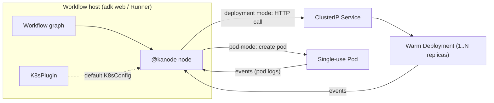
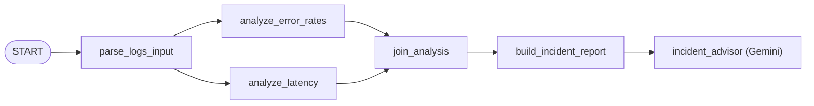

<div align="center">

# adk-kanode

**Run ADK Workflow nodes in their own Kubernetes pods with a single decorator.**


</div>

`adk-kanode` is an [ADK](https://google.github.io/adk-docs/) Workflow plugin and node
decorator (`@kanode` / `@k8s_node`). It extracts a node's implementation and executes
it inside a dedicated GKE / Kubernetes workload, while the workflow graph itself stays
plain ADK.

```python
@kanode
def analyze(node_input: list[str]) -> Event:
    """Runs in its own pod."""
    return Event(output={"lines": len(node_input)})
```

## Contents

- [Features](#features)
- [How it works](#how-it-works)
- [Installation](#installation)
- [Quick start](#quick-start)
- [Execution modes](#execution-modes)
- [Configuration](#configuration)
- [Running without a cluster](#running-without-a-cluster)
- [Example: log analyzer on GKE](#example-log-analyzer-on-gke)
- [Development](#development)
- [Disclaimer](#disclaimer)

## Features

- **Drop-in ADK Workflow Node (`K8sNode` / `KaNode`)**: Inherits from `google.adk.workflow.Node` (`BaseNode`), so `@kanode`-decorated nodes work anywhere in `Workflow(edges=[...])` — sequential chains, conditional routing maps, fan-out tuples, `JoinNode` fan-in, and `parallel_worker=True`.
- **Accepts Any ADK `NodeLike`**: Wrap sync/async functions, generators, `LlmAgent`, `BaseAgent`, `BaseTool` / `FunctionTool`, or custom `BaseNode` subclasses.
- **Automatic Implementation Extraction**: Inspects the wrapped function/node AST, strips the `@kanode` decorator so the pod runs the raw implementation, extracts module imports and Pydantic schemas, and runs the node inside a dedicated GKE pod via `python3 -u -c` without requiring manual entrypoint scripts.
- **ADK `K8sPlugin` (`BasePlugin`)**: Provides cluster-level default `K8sConfig` (configured via `ADK_K8S_*` environment variables or kwargs) and automatic pod cleanup on workflow completion or failure.

## How it works



1. `@kanode` wraps the node and extracts its source, imports and Pydantic schemas.
2. When the workflow reaches the node, the input is sent to a worker in the cluster.
3. The worker runs the original implementation and returns its ADK events to the workflow.

For the full technical details (source extraction, the worker protocol, rolling
updates and the security model), see [docs/ARCHITECTURE.md](docs/ARCHITECTURE.md).

## Installation

Requires Python 3.12+.

```bash
pip install "git+https://github.com/benmizrahi/adk-kanode.git"
```

Or with [uv](https://docs.astral.sh/uv/):

```bash
uv add "git+https://github.com/benmizrahi/adk-kanode.git"
```

## Quick start

```python
from google.adk.apps import App
from google.adk.events.event import Event
from google.adk.workflow import Workflow
from adk_kanode import K8sPlugin, kanode


@kanode
def task_C_node(node_input: str):
    """A FunctionNode to execute node C in a dedicated GKE pod."""
    return Event(output=f"Task C completed: {node_input}")


workflow = Workflow(
    name="my_gke_workflow",
    edges=[
        ("START", task_C_node),
    ],
)

app = App(
    name="my_app",
    root_agent=workflow,
    plugins=[K8sPlugin()],
)
```

## Execution modes

| Mode | What runs | Per-call latency | Use for |
| --- | --- | --- | --- |
| `deployment` (default) | One warm `Deployment` + `ClusterIP Service` per `@kanode` | one in-cluster HTTP call | Normal nodes |
| `pod` | A fresh pod per call, deleted afterwards | pod scheduling + Python startup | Strict one-shot isolation |

Set it globally with `ADK_K8S_MODE` / `K8sPlugin(mode=...)`, or per node:

```python
@kanode(replicas=3)   # warm Deployment with 3 replicas
def hot_node(node_input: str): ...

@kanode(mode="pod")   # fresh single-use pod per call
def isolated_node(node_input: str): ...
```

In deployment mode:

- Deployments are created on a node's first call. Call `plugin.prewarm(root_agent)`
  when the app loads to start them before the first request.
- Changing a node's code or config updates its Deployment with a rolling update.
- Deployments stay running when the app stops. Remove them with
  `kubectl delete deploy,svc -l app.kubernetes.io/managed-by=adk-kanode`.
- The workflow host must run inside the cluster; otherwise nodes fall back to `pod` mode.
- The host needs RBAC for `deployments`, `services` and the `adk-kanode-worker-token`
  Secret (the bearer token workers require). See `example/k8s.yaml`.
- A worker process is shared by concurrent calls. A node that blocks on CPU-heavy
  synchronous code delays other calls on that replica; raise `replicas` for those.

## Configuration

Settings resolve in this order: `@kanode(...)` arguments, then `K8sPlugin(...)`
arguments, then environment variables, then the built-in default.

```python
K8sPlugin(image="us-docker.pkg.dev/my-proj/adk/worker:latest", namespace="agents")

@kanode(memory_limit="1Gi", secret_env={"API_KEY": ("my-secret", "api-key")})
def call_api(node_input: str): ...
```

| Option | Environment variable | Default | Description |
| --- | --- | --- | --- |
| `image` | `ADK_K8S_IMAGE` | `python:3.12-slim` | Container image that runs the node |
| `namespace` | `ADK_K8S_NAMESPACE` | `default` | Namespace for workers |
| `service_account_name` | `ADK_K8S_SERVICE_ACCOUNT` | – | ServiceAccount for workers |
| `mode` | `ADK_K8S_MODE` | `deployment` | `deployment` or `pod` |
| `replicas` | `ADK_K8S_REPLICAS` | `1` | Warm replicas in deployment mode |
| `cpu_request` / `cpu_limit` | `ADK_K8S_CPU_REQUEST` / `ADK_K8S_CPU_LIMIT` | – | CPU resources |
| `memory_request` / `memory_limit` | `ADK_K8S_MEMORY_REQUEST` / `ADK_K8S_MEMORY_LIMIT` | – | Memory resources |
| `image_pull_policy` | `ADK_K8S_IMAGE_PULL_POLICY` | `IfNotPresent` | `Always`, `IfNotPresent` or `Never` |
| `image_pull_secrets` | `ADK_K8S_IMAGE_PULL_SECRETS` | – | Comma-separated secret names |
| `cleanup_pod` | `ADK_K8S_CLEANUP_POD` | `true` | Delete the pod after it finishes |
| `poll_interval` | `ADK_K8S_POLL_INTERVAL` | `1.0` | Seconds between pod status polls |
| `pod_startup_timeout` | `ADK_K8S_POD_STARTUP_TIMEOUT` | `300` | Seconds to wait for a pod or warm worker |
| `in_cluster` | `ADK_K8S_IN_CLUSTER` | auto-detect | Use in-cluster config or kubeconfig |
| `kubeconfig_path` | `ADK_K8S_KUBECONFIG` / `KUBECONFIG` | – | Path to a kubeconfig file |
| `context` | `ADK_K8S_CONTEXT` | – | kubeconfig context name |

These options are set in code only: `env`, `secret_env`, `labels`, `annotations`
and `node_selector`. Pass sensitive values through `secret_env`, which references
Kubernetes Secrets, rather than `env`.

Each `ADK_K8S_*` variable also accepts a `K8S_*` alias (for example `K8S_IMAGE`).

## Running without a cluster

Two executors run nodes locally, which is useful for development and tests:

| Executor | What it does |
| --- | --- |
| `SubprocessPodExecutor` | Runs the real pod bootstrap script in a local subprocess |
| `InProcessPodExecutor` | Runs the extracted node in the current process |

```python
from adk_kanode import K8sPlugin, SubprocessPodExecutor

plugin = K8sPlugin(executor=SubprocessPodExecutor())
```

An executor can also be set on a single node with `@kanode(executor=...)`.

## Example: log analyzer on GKE

[`example/agent.py`](example/agent.py) is a log-analysis workflow that fans out to
two parallel workers, joins their results, and hands a typed report to a Gemini agent.



Deploy it to an existing GKE cluster:

```bash
export ADK_K8S_IMAGE="us-docker.pkg.dev/<PROJECT_ID>/<REPO>/adk-kanode-example:latest"
export ADK_K8S_NAMESPACE="default"
export GOOGLE_CLOUD_PROJECT="<PROJECT_ID>"
export GOOGLE_CLOUD_LOCATION="<LOCATION>"

docker build -f example/Dockerfile -t "$ADK_K8S_IMAGE" .
docker push "$ADK_K8S_IMAGE"
envsubst < example/k8s.yaml | kubectl apply -f -
```

[`example/k8s.yaml`](example/k8s.yaml) creates the ServiceAccounts, the RBAC role,
and an `adk web` Deployment exposed through a `LoadBalancer` Service.

## Development

```bash
uv sync          # install dependencies
uv run pytest    # run the tests
```

| Path | Contents |
| --- | --- |
| [`src/adk_kanode/node.py`](src/adk_kanode/node.py) | `K8sNode` and the `@kanode` / `@k8s_node` decorator |
| [`src/adk_kanode/plugin.py`](src/adk_kanode/plugin.py) | `K8sPlugin` |
| [`src/adk_kanode/config.py`](src/adk_kanode/config.py) | `K8sConfig` and environment variable handling |
| [`src/adk_kanode/extractor.py`](src/adk_kanode/extractor.py) | Source extraction for wrapped nodes |
| [`src/adk_kanode/executor.py`](src/adk_kanode/executor.py) | Pod, subprocess and in-process executors |
| [`src/adk_kanode/deployment_executor.py`](src/adk_kanode/deployment_executor.py) | Warm Deployment executor |
| [`example/`](example/) | Log analyzer workflow, Dockerfile and manifests |

## Disclaimer

This is not an officially supported Google product. It is an independent project
and is not affiliated with, endorsed by, or maintained by Google.
