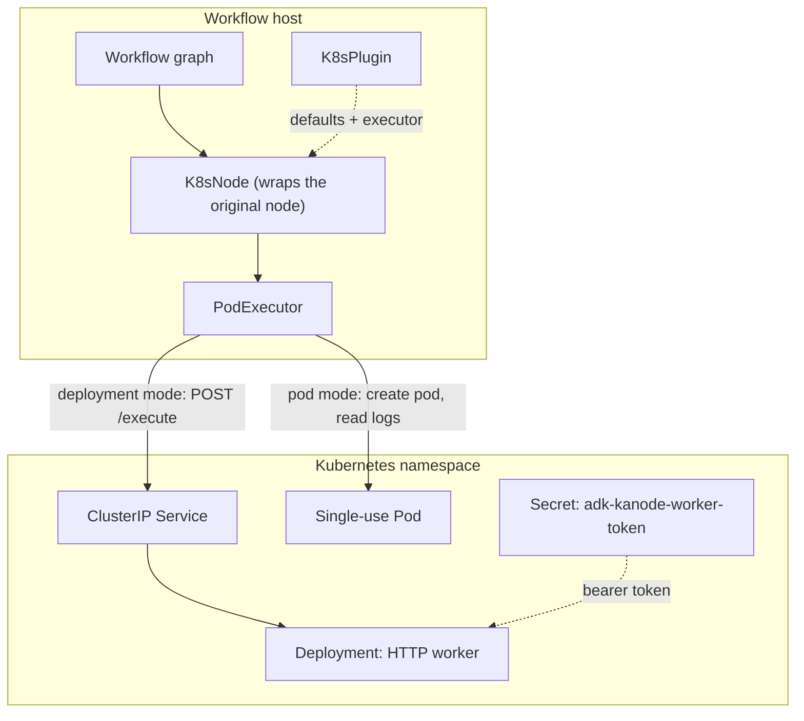
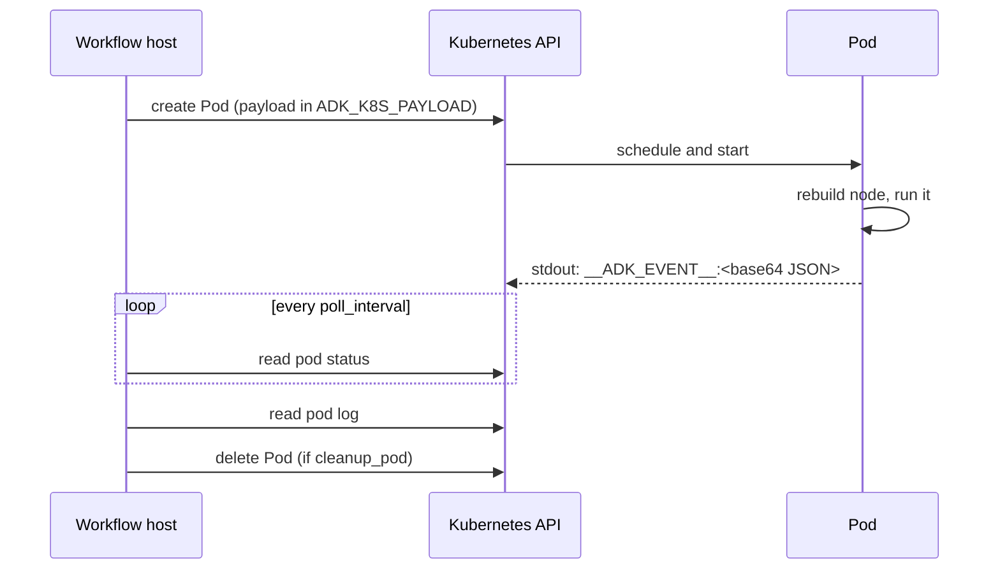
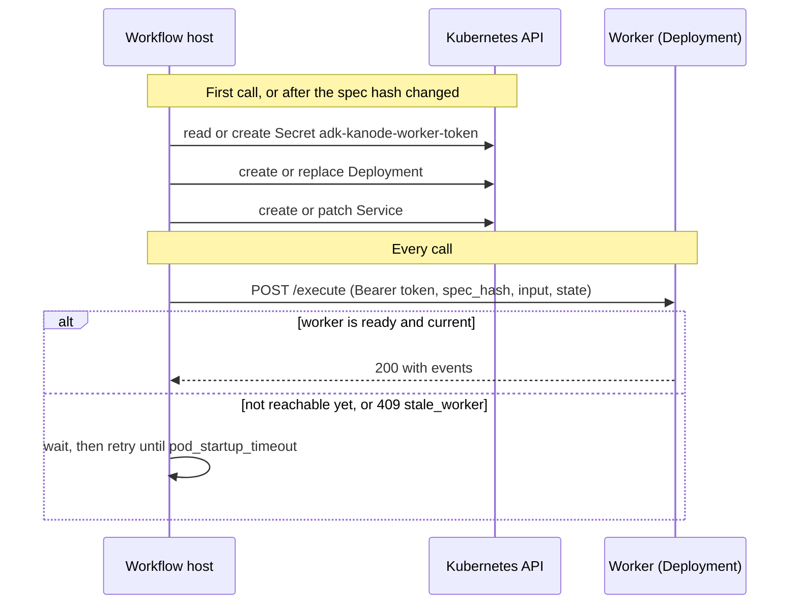

# Architecture

This document explains how `adk-kanode` moves an ADK Workflow node out of the
workflow process and into a Kubernetes workload. For installation and usage, see
the [README](../README.md).

## Contents

- [Overview](#overview)
- [Components](#components)
- [Lifecycle of a node call](#lifecycle-of-a-node-call)
- [Source extraction](#source-extraction)
- [Node reconstruction in the worker](#node-reconstruction-in-the-worker)
- [Payload and event transport](#payload-and-event-transport)
- [Pod mode](#pod-mode)
- [Deployment mode](#deployment-mode)
- [Configuration resolution](#configuration-resolution)
- [Plugin lifecycle](#plugin-lifecycle)
- [Security model](#security-model)
- [Limitations](#limitations)

## Overview

There are two processes involved in every `@kanode` call:

- The **workflow host** runs the ADK `Workflow` (through `adk web` or a `Runner`).
  It owns the graph, the session and the state.
- A **worker** runs one node's implementation inside the cluster and returns the
  ADK events that node emitted.

The host never ships a container image per node. Instead it sends the node's
*source code* to a generic image that has `google-adk` installed, and a small
bootstrap script rebuilds the node there.

## Components

| Module | Responsibility |
| --- | --- |
| [`node.py`](../src/adk_kanode/node.py) | `K8sNode` and the `@kanode` / `@k8s_node` decorator. Builds the payload and yields returned events. |
| [`extractor.py`](../src/adk_kanode/extractor.py) | Turns a node into a serializable `ExtractedImplementation`. |
| [`pod_runner.py`](../src/adk_kanode/pod_runner.py) | `PodExecutionPayload`, input serialization, event framing, in-process execution. |
| [`_bootstrap.py`](../src/adk_kanode/_bootstrap.py) | The self-contained Python scripts that run inside the worker. |
| [`executor.py`](../src/adk_kanode/executor.py) | `PodExecutor` interface, `K8sPodExecutor`, and the two local executors. |
| [`deployment_executor.py`](../src/adk_kanode/deployment_executor.py) | `K8sDeploymentExecutor`: warm Deployments, Services and the token Secret. |
| [`plugin.py`](../src/adk_kanode/plugin.py) | `K8sPlugin`: shared defaults, shared executor, prewarming, cleanup hooks. |
| [`config.py`](../src/adk_kanode/config.py) | `K8sConfig` and environment variable handling. |

## Lifecycle of a node call

`@kanode` runs once, when the module is imported:

1. ADK's own `build_node` turns the decorated object into a normal `BaseNode`.
2. `extract_node_implementation` captures its source (see below).
3. Both are stored on a `K8sNode`, which copies the inner node's name, schemas,
   retry and timeout settings so the workflow treats it like the original.

Each time the workflow reaches the node, `K8sNode.run_node_impl` does this:

1. **Host-side gates.** For function nodes, `require_confirmation` and
   `auth_config` are handled on the host. If either needs user input, the node
   yields the request and returns without contacting the cluster.
2. **Resolve config and executor.** The plugin's config is merged with the
   node's config, and the node's executor (if any) wins over the plugin's.
3. **Build the payload.** Input, the full session state and resume inputs are
   serialized into a `PodExecutionPayload`.
4. **Execute.** The executor returns a list of ADK `Event` objects.
5. **Yield.** Each event's `author` is set to the node name, its `state_delta`
   is applied to the host's state, and it is yielded to the workflow.

## Source extraction

`ExtractedImplementation` is a Pydantic model with these fields:

| Field | Contents |
| --- | --- |
| `kind` | `function`, `llm_agent`, `tool` or `custom_node` |
| `name` | The ADK node name |
| `module_name`, `qualname` | Where the object was defined, used for the import attempt |
| `func_name` | Name to look up after compiling `source_code` |
| `source_code` | Source of the function or class, with node decorators removed |
| `module_preamble` | Imports and classes copied from the defining module |
| `parameter_binding` | `state` or `node_input`, for function nodes |
| `node_config` | Serialized settings for `LlmAgent` and custom nodes |

How each kind is extracted:

- **Function** (and `FunctionNode`): `inspect.getsource` reads the function, the
  source is parsed to an AST, and `@kanode`, `@k8s_node`, `@kanote` and `@node`
  decorators are removed so the worker gets the plain function.
- **Tool**: a `FunctionTool` is extracted through its underlying function. Other
  `BaseTool` subclasses are extracted as class source.
- **`LlmAgent`**: no source is taken. Only these settings are serialized: `name`,
  `description`, `instruction`, `model`, `output_key`, `include_contents`, `mode`,
  the two `disallow_transfer_*` flags, and the `output_schema` class.
- **Custom `BaseNode` / `BaseAgent`**: class source plus `model_dump(mode="json")`
  of the instance.

The **module preamble** is built from the top level of the module that defines
the node. It keeps:

- `import` and `from ... import` statements, except relative imports and imports
  of `adk_kanode` itself.
- Class definitions that are not decorated as nodes, which covers Pydantic schemas.

## Node reconstruction in the worker

The worker rebuilds the node in this order:

1. **Import.** It tries `importlib.import_module(module_name)` and walks
   `qualname`. This succeeds when the worker image contains your code, as in the
   example image. If the imported object is a `K8sNode`, its `inner_node` is used.
2. **`LlmAgent` from config.** A new `LlmAgent` is created from `node_config`.
   The preamble is compiled only to recover the output schema class.
3. **Compile from source.** `module_preamble` and `source_code` are joined,
   parsed, compiled and executed in a namespace that already contains common ADK
   names (`Event`, `Context`, `types`, `BaseModel`, `Field`, `Agent`,
   `FunctionTool` and others). The object named `func_name` is then wrapped with
   `build_node`.

Importing is skipped for `__main__` and for objects defined inside a function
(`<locals>` in the qualified name), so those always use the source path.

The worker then creates a fresh `InMemorySessionService`, a `Session` seeded with
the state from the payload, an `InvocationContext` and a `Context`, and runs the
node. Deferred `ctx.output`, `ctx.route` and state changes are flushed into a
final event so nothing is lost.

## Payload and event transport

`PodExecutionPayload` carries everything a call needs:

| Field | Contents |
| --- | --- |
| `node_name`, `node_path`, `run_id` | Identity of this node run |
| `invocation_id`, `session_id` | Identity of the host invocation and session |
| `node_input`, `node_input_is_content` | JSON-serialized input, and whether it was a `types.Content` |
| `state` | A copy of the full session state |
| `resume_inputs` | Inputs for resumed (human-in-the-loop) runs |
| `extracted` | The `ExtractedImplementation` |

Pydantic models in the input are converted with `model_dump(mode="json")`, so
the worker receives plain dicts and lists. State changes travel back as
`state_delta` on the returned events; the worker never writes to the host's
session directly.

## Pod mode

One pod is created per call.

- The container command is `python3 -u -c <bootstrap script>`. The script is
  passed inline, so `adk_kanode` does not need to be installed in the image.
- The payload is base64-encoded JSON in the `ADK_K8S_PAYLOAD` environment
  variable, so its size is limited by what a pod spec can hold.
- Each event is printed as one line: `__ADK_EVENT__:` followed by base64 JSON.
  Other output on stdout is ignored when the log is parsed.
- The host polls until the pod is `Succeeded` or `Failed`. `pod_startup_timeout`
  bounds the whole run in this mode, not only startup.
- A `Failed` pod raises `K8sPodExecutionError` with the pod log attached.
- The pod has `restartPolicy: Never` and is named
  `<node>-<run id>-<8 random hex chars>`.

## Deployment mode

Each node gets a long-lived `Deployment` and `ClusterIP Service`, both named
after the node (`my_node` becomes `my-node`).

### Provisioning

- **Spec hash.** A SHA-256 over the extracted implementation, the config (minus
  host-only fields) and the worker script, truncated to 16 hex characters. It is
  stored in the `adk.google.com/spec-hash` annotation.
- **Create or update.** A missing object is created. An existing object is
  updated only when its hash differs, which gives a rolling update when the
  node's code or config changes.
- **Ownership check.** An existing object without the label
  `app.kubernetes.io/managed-by=adk-kanode` is never overwritten; the call fails
  and asks you to rename the node.
- **Caching.** The host remembers the hash it last applied per node, so normal
  calls make no Kubernetes API requests.
- **Token.** One Secret per namespace holds a random bearer token. It is created
  on first use and mounted into workers through a `secretKeyRef`.

### The worker

The worker is a Starlette app served by uvicorn on port 8080. It rebuilds its
node **once at startup** from the `ADK_K8S_NODE_SPEC` environment variable.

| Endpoint | Purpose |
| --- | --- |
| `GET /healthz` | Readiness probe. Returns the worker's spec hash. |
| `POST /execute` | Runs the node for one payload and returns its events as JSON. |

`/execute` responses:

| Status | Meaning |
| --- | --- |
| `200` | `{"events": [...]}` |
| `400` | Body is not a JSON object |
| `401` | Missing or wrong bearer token |
| `409` | `stale_worker`: the request's `spec_hash` does not match this worker |
| `413` | Body larger than `ADK_K8S_WORKER_MAX_BODY_BYTES` (default 32 MiB) |
| `500` | The node raised; the body has the exception type and message |

The request body is the payload *without* `extracted`. A worker only ever runs
the code it was started with; requests supply inputs and state, never code.

### Host retry rules

The host retries only when the node certainly did not run:

- The worker is not reachable yet (connection error or connect timeout).
- The worker answered `409` or `503`.

Retries continue until `pod_startup_timeout`. Any other response raises
`K8sPodExecutionError`. After a `401` the host also drops its cached token, so
the next call reads the Secret again.

### Falling back to pod mode

Worker Services resolve only inside the cluster. Deployment mode is used when
`in_cluster=True`, or when `in_cluster` is unset and `KUBERNETES_SERVICE_HOST`
is present. Otherwise the host logs a warning and runs the node as a one-shot pod.

## Configuration resolution

For each call the effective config is `plugin.config.merge_with(node.k8s_config)`:

- Only fields set explicitly on the node override the plugin's values.
- `env`, `secret_env`, `labels`, `annotations` and `node_selector` are merged
  key by key, with the node winning on conflicts.
- `image_pull_secrets` from both are combined without duplicates.
- `volumes` and `volume_mounts` are replaced by the node's values when set.
- A field set on neither falls back to its environment variable, then its default.

Without a registered `K8sPlugin`, the node's own config is used with a shared
default `K8sDeploymentExecutor`.

## Plugin lifecycle

| Hook | What `K8sPlugin` does |
| --- | --- |
| `before_run_callback` | Registers itself as the active plugin for the invocation |
| `after_run_callback` | Calls `executor.cleanup_all()` |
| `on_run_error_callback` | Calls `executor.cleanup_all()` |
| `close` | Calls `executor.close()` |

A node finds the plugin through the invocation's plugin manager, and falls back
to a context variable set in `before_run_callback`.

`prewarm(root)` walks the workflow graph, collects every `@kanode` without its
own executor, and provisions their Deployments on a background thread. It does
nothing inside a worker (detected through `ADK_K8S_WORKER`), so importing the
agent module in a worker never creates cluster resources.

One-shot pods are deleted in a `finally` block after each call. Warm Deployments
are left running on purpose when the app stops.

## Security model

- **Authentication.** `/execute` requires the shared bearer token, compared in
  constant time. A worker refuses to start without a token.
- **No code over HTTP.** Node code reaches a worker only through its Deployment
  spec. Changing what a worker runs requires write access to Deployments.
- **Separate identities.** The example gives the host a ServiceAccount with the
  RBAC it needs, and gives workers a second ServiceAccount with no API permissions.
- **Container hardening.** Workers run with `allowPrivilegeEscalation: false`
  and the `RuntimeDefault` seccomp profile.
- **Reserved variables.** `env` and `secret_env` cannot override
  `ADK_K8S_NODE_SPEC`, `ADK_K8S_SPEC_HASH`, `ADK_K8S_WORKER` or
  `ADK_K8S_WORKER_TOKEN` in deployment mode.
- **Secrets.** Use `secret_env` so values come from Kubernetes Secrets. Values in
  `env` are written into the pod spec in plain text.

Things to be aware of:

- Host-to-worker traffic is plain HTTP inside the cluster. Use a service mesh if
  it must be encrypted.
- The token is shared by all workers in a namespace.
- Node source and, in pod mode, the full payload including session state are
  visible to anyone who can read pods or Deployments in the namespace.
- There is no per-client rate limiting on the worker.

## Limitations

- **Module-level helpers.** The preamble copies imports and classes only.
  Module-level functions, constants and relative imports are not copied. A node
  that uses them needs its module to be importable in the worker image.
- **Closures.** Variables captured from an enclosing function are not transferred.
- **`LlmAgent` settings.** Only the fields listed under
  [Source extraction](#source-extraction) are transferred. Tools, callbacks and
  sub-agents are not. A non-string `instruction` becomes empty, and a non-string
  `model` becomes `gemini-2.5-flash`.
- **Dependencies.** The worker image must contain `google-adk` and every package
  the node imports.
- **Shared worker process.** In deployment mode, concurrent calls share a worker
  process. CPU-heavy synchronous code blocks other calls on that replica.
- **Name collisions.** Deployment names come from node names, so two different
  nodes with the same name in one namespace share a Deployment and replace each
  other's code.
- **Private ADK modules.** The package imports from `google.adk.workflow._*`
  modules, which may change between ADK releases.
