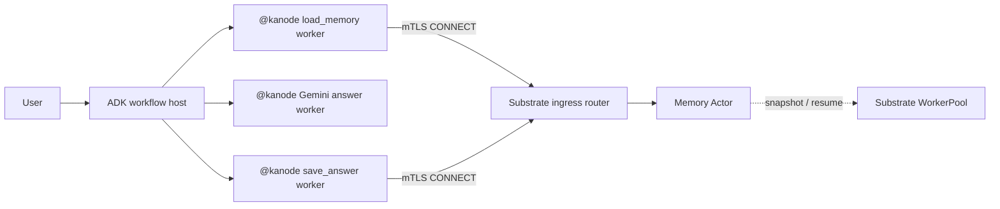

# ADK-Kanode with Agent Substrate on GKE

This example puts ADK-Kanode directly in the request path:

- **ADK-Kanode** runs all three workflow steps (`load_memory`, the Gemini
  `answer_agent`, and `save_answer`) in separate warm Kubernetes Deployments.
  The `adk web` host coordinates the ADK workflow and passes data between them.
- **Agent Substrate** runs a stateful memory Actor in its sandboxed WorkerPool.
  When idle, Substrate snapshots the Actor and releases its Worker; the next
  request resumes it with its in-memory conversation history.

The two memory nodes use their projected Substrate identity to call the Actor
through Substrate's mTLS ingress router. The Actor remains an independent
Substrate workload; it is not managed by ADK-Kanode's Deployment or Pod executor.



The Actor is deliberately a small stateful service rather than another ADK
agent. It shows how ADK-Kanode can distribute the full ADK workflow while
Substrate owns only the durable, suspendable memory service.

## Requirements

- Agent Substrate on GKE installed on a **GKE Standard** cluster. The control
  plane and node pools must run GKE 1.37 or later; the cluster must use
  Dataplane V2, and the nodes must use `c3-standard-4` or larger machine types
  without mixed CPU architectures.
  See Google's [Agent Substrate installation requirements](https://docs.cloud.google.com/kubernetes-engine/ai-ml/install-overview-substrate).
- Do not enable GKE Sandbox on the nodes that run Substrate Workers. Substrate
  provides its own gVisor sandbox runtime.
- The ADK workflow host must run in the same cluster, with the existing
  `adk-workflow-sa` ServiceAccount and RBAC from [`../k8s.yaml`](../k8s.yaml).
- Vertex AI access for the existing `adk-worker-sa` through Workload Identity.
- `kubectl ate`, `envsubst`, Docker, and an Artifact Registry repository.

Configure Substrate's router to allow the Kanode worker identity:

```text
spiffe://cluster.local/ns/<ADK_K8S_NAMESPACE>/sa/adk-worker-sa
```

Include this ID in the full `ATE_INGRESS_ALLOWED_SPIFFE_IDS` list when
installing Substrate; the installer replaces, rather than appends to, the
router's allowlist.
For an existing installation, redeploy `atenet` with the full allowlist using
the install record and instructions in the
[substrate-gke guide](https://github.com/ai-on-gke/substrate-gke#reaching-actors-through-the-ingress-router).
The memory workers get a projected pod certificate and the router's trust
bundle from their `@kanode` configuration.

## Build and deploy

Run these commands from the repository root. Set the project, region, registry,
and namespace for your environment. Use the same Substrate gVisor worker image
version that is installed in your cluster.

```bash
export ADK_K8S_NAMESPACE="default"
export GOOGLE_CLOUD_PROJECT="<PROJECT_ID>"
export GOOGLE_CLOUD_LOCATION="<LOCATION>"
export SUBSTRATE_ATESPACE="adk-kanode-memory"
export SUBSTRATE_ACTOR_NAME="adk-chat-1"
export SUBSTRATE_WORKER_IMAGE="<SUBSTRATE_GVISOR_WORKER_IMAGE>"
export ADK_K8S_IMAGE="us-docker.pkg.dev/<PROJECT_ID>/<REPO>/adk-kanode-agent-substrate:latest"
export MEMORY_ACTOR_IMAGE="us-docker.pkg.dev/<PROJECT_ID>/<REPO>/adk-kanode-memory:latest"

docker build --network=host -f examples/Dockerfile \
  --build-arg AGENT_SRC=examples/agent-substrate \
  --build-arg AGENT_NAME=agent_substrate \
  -t "$ADK_K8S_IMAGE" .
docker push "$ADK_K8S_IMAGE"

docker build -f examples/agent-substrate/Dockerfile \
  -t "$MEMORY_ACTOR_IMAGE" examples/agent-substrate
docker push "$MEMORY_ACTOR_IMAGE"

envsubst < examples/agent-substrate/worker-pool.yaml | kubectl apply -f -
kubectl ate create atespace "$SUBSTRATE_ATESPACE"
envsubst < examples/agent-substrate/actor-template.yaml \
  | kubectl ate create actor-template -f -
kubectl ate create actor "$SUBSTRATE_ACTOR_NAME" \
  -a "$SUBSTRATE_ATESPACE" --template durable-memory

envsubst < examples/k8s.yaml | kubectl apply -f -
kubectl rollout status deployment/adk-web-example -n "$ADK_K8S_NAMESPACE"
kubectl port-forward svc/adk-web-example-svc 8080:80 -n "$ADK_K8S_NAMESPACE"
```

Open <http://localhost:8080> and select `agent_substrate`. Send a few messages,
then suspend the actor synchronously:

```bash
kubectl ate suspend actor "$SUBSTRATE_ACTOR_NAME" \
  -a "$SUBSTRATE_ATESPACE" --mode=sync
```

Send another message. Substrate resumes the Actor, and its prior conversation
turns remain available to the Gemini node.

## Configuration and trust boundaries

- The example configures one Actor name for clarity. For a real multi-user
  service, map each authorized conversation to its own Actor; do not let an
  untrusted user choose arbitrary atespace or actor names.
- Conversation content is untrusted input. The workflow instructs Gemini to
  treat stored turns as content, not system instructions.
- Only the `adk-worker-sa` identity is authorized for actor ingress. The
  workflow host does not receive the Substrate client identity, and the memory
  Actor does not receive Vertex AI credentials.
- The Actor's `SNAPSHOT_FIDELITY_MEMORY` setting preserves its process memory
  across suspend/resume. External connections are not preserved; this Actor
  stores no open connections.
- ADK-Kanode's warm Gemini worker and the Substrate Actor have independent
  lifecycles. Do not set `runtime_class_name="gvisor"` on the ADK-Kanode node
  for this integration; Substrate's WorkerPool owns the Actor sandbox.

Remove the actor before deleting its atespace:

```bash
kubectl ate delete actor "$SUBSTRATE_ACTOR_NAME" -a "$SUBSTRATE_ATESPACE"
kubectl ate delete atespace "$SUBSTRATE_ATESPACE"
kubectl delete namespace "$SUBSTRATE_ATESPACE"
```
