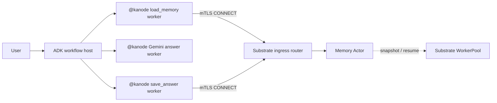

# ADK-Kanode with Agent Substrate on GKE

This example puts ADK-Kanode directly in the request path:

- **ADK-Kanode** runs all three workflow steps (`load_memory`, the Gemini
  `answer_agent`, and `save_answer`) in separate warm Kubernetes Deployments.
  The `adk web` host coordinates the ADK workflow and passes data between them.
- **Agent Substrate** runs a stateful memory Actor in its sandboxed WorkerPool.
  When idle, Substrate snapshots the Actor and releases its Worker; the next
  request resumes it with its in-memory conversation history.

The two memory nodes use their projected Substrate identity to call the Actor
through Substrate's mTLS ingress router. The Actor remains an independent
Substrate workload; it is not managed by ADK-Kanode's Deployment or Pod executor.



The Actor is deliberately a small stateful service rather than another ADK
agent. It shows how ADK-Kanode can distribute the full ADK workflow while
Substrate owns only the durable, suspendable memory service.

## Requirements

For a new deployment, follow these steps in order. Agent Substrate's installer
can create the GKE cluster and install Substrate in one flow. Its Google Cloud
resources are billable; review the upstream install and
[teardown instructions](https://github.com/ai-on-gke/substrate-gke#tearing-down)
before proceeding.

Create a Google Cloud project and attach billing if you do not already have
one. The current installer requires Go 1.27.3 or later. Use a local
workstation (not Cloud Shell) with `gcloud`, `kubectl`,
`gke-gcloud-auth-plugin`, Git, Make, Docker with Buildx, `uv`, and `envsubst`.
See the official
[prerequisites and cluster requirements](https://docs.cloud.google.com/kubernetes-engine/ai-ml/install-overview-substrate).
The cluster must be GKE Standard, use Dataplane V2, run GKE 1.37 or later on
the control plane and every node pool, and use supported single-architecture
machine types (`c3-standard-4` or larger). Do not enable GKE Sandbox for
Substrate's WorkerPool; Substrate supplies its own gVisor sandbox.

### 1. Set project and deployment variables

Choose a project with billing enabled. Run the following in a terminal from
the root of your `adk-kanode` checkout; replace the example values. Keep this
shell open so the exported variables are available for the later steps.

```bash
export GOOGLE_CLOUD_PROJECT="<PROJECT_ID>"
export GOOGLE_CLOUD_LOCATION="us-central1"
export AR_REGION="us-central1"
export AR_REPOSITORY="adk-kanode"
export ADK_K8S_NAMESPACE="default"
export SUBSTRATE_ATESPACE="adk-kanode-memory"
export SUBSTRATE_ACTOR_NAME="adk-chat-1"
export REGISTRY="${AR_REGION}-docker.pkg.dev/${GOOGLE_CLOUD_PROJECT}/${AR_REPOSITORY}"
export ADK_K8S_IMAGE="${REGISTRY}/agent-substrate:latest"
export MEMORY_ACTOR_IMAGE="${REGISTRY}/memory-actor:latest"

gcloud auth login
gcloud auth application-default login
gcloud config set project "$GOOGLE_CLOUD_PROJECT"
gcloud services enable aiplatform.googleapis.com artifactregistry.googleapis.com \
  --project="$GOOGLE_CLOUD_PROJECT"
gcloud auth configure-docker "${AR_REGION}-docker.pkg.dev"
```

`GOOGLE_CLOUD_LOCATION` is the Vertex AI region. `AR_REGION` is the Artifact
Registry region; they may be the same. Create a Docker repository if the
project does not already have one:

```bash
gcloud artifacts repositories describe "$AR_REPOSITORY" \
  --location="$AR_REGION" >/dev/null ||
gcloud artifacts repositories create "$AR_REPOSITORY" \
  --repository-format=docker \
  --location="$AR_REGION" \
  --description="Images for the ADK-Kanode Agent Substrate example"
```

### 2. Create the GKE cluster and install Agent Substrate

Clone and run the upstream installer. `make dry-run` previews the wizard
without provisioning resources. Before `make run`, add the Kanode worker's
SPIFFE identity to the ingress allowlist:

```bash
git clone https://github.com/ai-on-gke/substrate-gke.git
cd substrate-gke
make dry-run

export ATE_INGRESS_ALLOWED_SPIFFE_IDS="spiffe://cluster.local/ns/${ADK_K8S_NAMESPACE}/sa/adk-worker-sa"
make run
```

In the wizard, choose your project, select **create a new cluster**, and
choose a region/zone. Use a supported GKE Standard configuration meeting the
requirements above (including Dataplane V2 and `c3-standard-4` or larger
machines). Choose the gVisor sandbox runtime. Complete the provisioning,
ingress-client, and Substrate install steps; the wizard enables required APIs
and configures the supporting Google Cloud resources. If you already have a
supported cluster, select it instead and confirm that Workload Identity
Federation for GKE is enabled.

If provisioning fails with `network "default" does not exist`, the project
does not have the VPC network that the installer uses by default. Create an
auto-mode default VPC, then rerun `make run` and continue from the failed
provisioning step:

```bash
gcloud compute networks create default \
  --subnet-mode=auto \
  --project="$GOOGLE_CLOUD_PROJECT"
```

If your organization requires a custom VPC, use the wizard's advanced
network settings instead and select an existing VPC and subnet in the
cluster's region.

The allowlist is the complete list, not an additive change. If other clients
already need router access, include their SPIFFE IDs as comma-separated entries
in `ATE_INGRESS_ALLOWED_SPIFFE_IDS`. When the installer finishes, confirm
`kubectl` is pointed at the installed cluster:

```bash
kubectl get nodes
```

### 3. Set the Substrate worker image and grant Vertex AI access

Set `SUBSTRATE_WORKER_IMAGE` to the gVisor worker image for the Substrate
version installed by the wizard. Use that image for the WorkerPool below; it
is different from the memory Actor image that you will build in the next step.
For the installer's default pre-built Substrate v1.0.0 release, use:

```bash
export SUBSTRATE_WORKER_IMAGE="ghcr.io/agent-substrate/substrate/ateworker-gvisor:v1.0.0"
```

If you selected a different release or built Substrate from source, use the
`ateworker-gvisor` image from the same registry and tag you selected in the
installer. Keep this export in the same shell you use for the deployment
commands; do not include placeholder angle brackets in the image reference.

Grant the worker Kubernetes ServiceAccount permission to call Vertex AI:

```bash
PROJECT_NUMBER="$(gcloud projects describe "$GOOGLE_CLOUD_PROJECT" \
  --format='value(projectNumber)')"
gcloud projects add-iam-policy-binding "$GOOGLE_CLOUD_PROJECT" \
  --member="principal://iam.googleapis.com/projects/${PROJECT_NUMBER}/locations/global/workloadIdentityPools/${GOOGLE_CLOUD_PROJECT}.svc.id.goog/subject/ns/${ADK_K8S_NAMESPACE}/sa/adk-worker-sa" \
  --role="roles/aiplatform.user"
```

The installer enables Workload Identity Federation for GKE on a new cluster.
The host and Kanode workers will run in `ADK_K8S_NAMESPACE`; the Substrate
Actor runs separately in `SUBSTRATE_ATESPACE`.

### 4. Build and push the two application images

Return to the root of your `adk-kanode` checkout (`cd ..` if you cloned
`substrate-gke` there). Build and push the ADK web host image and the separate
memory Actor image:

```bash
# The shared Dockerfile uses a lockfile. Generate it if this checkout has none.
test -f uv.lock || uv lock

docker build --network=host -f examples/Dockerfile \
  --build-arg AGENT_SRC=examples/agent-substrate \
  --build-arg AGENT_NAME=agent_substrate \
  -t "$ADK_K8S_IMAGE" .
docker push "$ADK_K8S_IMAGE"

docker build -f examples/agent-substrate/Dockerfile \
  -t "$MEMORY_ACTOR_IMAGE" examples/agent-substrate
docker push "$MEMORY_ACTOR_IMAGE"
```

If the build fails with a BuildKit error such as `missing parent ... bucket:
not found`, the local builder's snapshot cache is likely inconsistent; this is
not caused by the `WORKDIR` instruction. Restart Docker and retry the build. If
it still fails, clear the current builder's cache and rebuild (this removes
cached layers, so the next build may take longer):

```bash
docker buildx prune
```

### 5. Create the Substrate atespace, WorkerPool, and Actor

Apply the WorkerPool manifest. It also creates the Kubernetes namespace named
by `SUBSTRATE_ATESPACE`. Then create the atespace, register the Actor template,
and create the memory Actor:

The `kubectl ate` commands are provided by the separate `kubectl-ate` plugin.
For the default Substrate v1.0.0 release, install it from the matching source
checkout and add Go's binary directory to `PATH`:

```bash
git clone --depth 1 --branch v1.0.0 \
  https://github.com/agent-substrate/substrate.git /tmp/substrate-v1.0.0
go -C /tmp/substrate-v1.0.0 install ./cmd/kubectl-ate
export PATH="$(go env GOPATH)/bin:$PATH"
kubectl ate --help
```

If you installed a different Substrate revision, build the plugin from that
same revision instead.

```bash
: "${SUBSTRATE_WORKER_IMAGE:?Set SUBSTRATE_WORKER_IMAGE to the installed Substrate gVisor worker image}"
case "$SUBSTRATE_WORKER_IMAGE" in
  *'<'*|*'>'*) echo "Replace the worker image placeholder with a real image reference" >&2; exit 1 ;;
esac
envsubst < examples/agent-substrate/worker-pool.yaml | kubectl apply -f -
kubectl ate create atespace "$SUBSTRATE_ATESPACE"

envsubst < examples/agent-substrate/actor-template.yaml \
  | kubectl ate create actor-template -f -
kubectl ate create actor "$SUBSTRATE_ACTOR_NAME" \
  -a "$SUBSTRATE_ATESPACE" --template durable-memory
```

### 6. Deploy the ADK workflow host and Kanode workers

The Artifact Registry credentials configured with `gcloud auth configure-docker`
allow your workstation to push images; GKE uses separate identities to pull
them. Grant the node service account read access to this application repository
for the workflow host image, and grant Substrate's `atelet` Workload Identity
principal access for the memory Actor image. The new-cluster installer defaults
the node service account to `ate-gke-node`; if using an existing cluster or a
custom node service account, use the account assigned to its node pools.

```bash
PROJECT_NUMBER="$(gcloud projects describe "$GOOGLE_CLOUD_PROJECT" \
  --format='value(projectNumber)')"
NODE_SERVICE_ACCOUNT="ate-gke-node@${GOOGLE_CLOUD_PROJECT}.iam.gserviceaccount.com"
ATELET_PRINCIPAL="principal://iam.googleapis.com/projects/${PROJECT_NUMBER}/locations/global/workloadIdentityPools/${GOOGLE_CLOUD_PROJECT}.svc.id.goog/subject/ns/ate-system/sa/atelet"

gcloud artifacts repositories add-iam-policy-binding "$AR_REPOSITORY" \
  --location="$AR_REGION" \
  --project="$GOOGLE_CLOUD_PROJECT" \
  --member="serviceAccount:${NODE_SERVICE_ACCOUNT}" \
  --role="roles/artifactregistry.reader"
gcloud artifacts repositories add-iam-policy-binding "$AR_REPOSITORY" \
  --location="$AR_REGION" \
  --project="$GOOGLE_CLOUD_PROJECT" \
  --member="$ATELET_PRINCIPAL" \
  --role="roles/artifactregistry.reader"
```

Apply the host Deployment, its ServiceAccounts, and the RBAC that lets the host
manage Kanode workers. The manifest uses the exported project, namespace, and
image values:

```bash
envsubst < examples/k8s.yaml | kubectl apply -f -
kubectl rollout status deployment/adk-web-example -n "$ADK_K8S_NAMESPACE"
```

The host creates three Kanode worker Deployments on demand. Check them after
the first request. The workflow host Service is a public `LoadBalancer` in this
example; the ADK Web UI does not provide production authentication. Restrict
access to the endpoint or put it behind an authenticated gateway before using
it beyond a private test.

### 7. Try the workflow and verify suspend/resume

The Service in [`../k8s.yaml`](../k8s.yaml) defaults to a public
`LoadBalancer`. For local-only testing, change it to `ClusterIP` before
forwarding the port:

```bash
kubectl patch service adk-web-example-svc \
  -n "$ADK_K8S_NAMESPACE" \
  --type merge \
  -p '{"spec":{"type":"ClusterIP"}}'
kubectl port-forward svc/adk-web-example-svc 8080:80 \
  -n "$ADK_K8S_NAMESPACE"
```

Open <http://localhost:8080>, select `agent_substrate`, and send a few
messages. Suspend the Actor synchronously:

```bash
kubectl ate suspend actor "$SUBSTRATE_ACTOR_NAME" \
  -a "$SUBSTRATE_ATESPACE" --mode=sync
```

Send another message. Substrate resumes the Actor, and its earlier conversation
turns remain available to the Gemini node. The first call to each Kanode node
creates its warm Deployment; subsequent calls reuse those workers.

## Configuration and trust boundaries

- The example configures one Actor name for clarity. For a real multi-user
  service, map each authorized conversation to its own Actor; do not let an
  untrusted user choose arbitrary atespace or actor names.
- Conversation content is untrusted input. The workflow instructs Gemini to
  treat stored turns as content, not system instructions.
- Only the `adk-worker-sa` identity is authorized for actor ingress. The
  workflow host does not receive the Substrate client identity, and the memory
  Actor does not receive Vertex AI credentials.
- The Actor's `SNAPSHOT_FIDELITY_MEMORY` setting preserves its process memory
  across suspend/resume. External connections are not preserved; this Actor
  stores no open connections.
- ADK-Kanode's warm Gemini worker and the Substrate Actor have independent
  lifecycles. Do not set `runtime_class_name="gvisor"` on the ADK-Kanode node
  for this integration; Substrate's WorkerPool owns the Actor sandbox.

Remove the actor before deleting its atespace:

```bash
kubectl ate delete actor "$SUBSTRATE_ACTOR_NAME" -a "$SUBSTRATE_ATESPACE"
kubectl ate delete atespace "$SUBSTRATE_ATESPACE"
kubectl delete namespace "$SUBSTRATE_ATESPACE"
```
