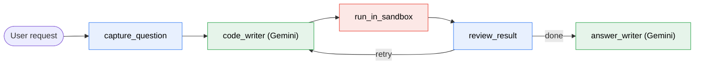

# Zero-trust code interpreter on GKE Sandbox

Gemini writes a Python script, a throwaway [GKE Sandbox](https://cloud.google.com/kubernetes-engine/docs/how-to/sandbox-pods)
(gVisor) pod runs it, and Gemini answers from the output. If the script fails,
the error goes back to Gemini for another attempt.

It is one ADK `Workflow`. Each node declares where it runs, so the trust
boundary sits around a single node instead of around a separate service.



## Trust zones

| Zone | Nodes | Runs as | Can reach |
| --- | --- | --- | --- |
| Host | `capture_question`, `review_result` | the `adk web` process | session state, Kubernetes API |
| Trusted workers | `code_writer`, `answer_writer` | warm Deployments, `adk-worker-sa` | Vertex AI |
| Sandbox | `run_in_sandbox` | single-use gVisor pod, `adk-sandbox-sa` | nothing |

The sandbox node is the only one that touches LLM-generated code:

```python
@kanode(
    mode="pod",                    # a fresh pod per run, deleted afterwards
    runtime_class_name="gvisor",   # syscalls hit gVisor, not the node kernel
    node_selector={"cloud.google.com/compute-class": "sandbox-gvisor-class"},
    service_account_name="adk-sandbox-sa",  # no RBAC, no IAM, no mounted token
    labels={"trust-zone": "sandbox"},       # selected by the deny-all NetworkPolicy
)
def run_in_sandbox(node_input: dict[str, Any]) -> Event: ...
```

Each setting closes a different door:

| Layer | Setting | What it stops |
| --- | --- | --- |
| Kernel | `runtime_class_name="gvisor"` | container escapes through node kernel bugs |
| Lifetime | `mode="pod"` | anything the script leaves behind reaching the next run |
| Identity | `adk-sandbox-sa` | calls to the Kubernetes API or Google Cloud APIs |
| Network | `adk-sandbox-deny-all` | exfiltration, metadata server, other pods |
| Data | `review_result` on the host | malformed or oversized results reaching Gemini |

Pod mode needs no network: the input arrives in the pod spec and the result
leaves through the pod log. That is why the NetworkPolicy can deny everything.

## Files

| File | Contents |
| --- | --- |
| [`code_interpreter/agent.py`](code_interpreter/agent.py) | The workflow |
| [`gVisor.yaml`](gVisor.yaml) | `ComputeClass` that auto-creates gVisor node pools |
| [`sandbox-policy.yaml`](sandbox-policy.yaml) | Sandbox ServiceAccount and deny-all NetworkPolicy |

The host Deployment, its RBAC and `adk-worker-sa` come from
[`../k8s.yaml`](../k8s.yaml), and the image from [`../Dockerfile`](../Dockerfile).

## Deploy

You need a GKE cluster with node pool auto-creation and network policy
enforcement (Dataplane V2), and Vertex AI access for `adk-worker-sa` through
Workload Identity. Run from the repository root:

```bash
export ADK_K8S_IMAGE="us-docker.pkg.dev/<PROJECT_ID>/<REPO>/adk-kanode-code-interpreter:latest"
export ADK_K8S_NAMESPACE="default"
export GOOGLE_CLOUD_PROJECT="<PROJECT_ID>"
export GOOGLE_CLOUD_LOCATION="<LOCATION>"

docker build --network=host -f examples/Dockerfile \
  --build-arg AGENT_SRC=examples/gke-sandbox/code_interpreter \
  --build-arg AGENT_NAME=code_interpreter \
  -t "$ADK_K8S_IMAGE" .
docker push "$ADK_K8S_IMAGE"

kubectl apply -f examples/gke-sandbox/gVisor.yaml
envsubst < examples/gke-sandbox/sandbox-policy.yaml | kubectl apply -f -
envsubst < examples/k8s.yaml | kubectl apply -f -
```

Open the `adk-web-example-svc` address and pick the `code_interpreter` app.
The first request can take a few minutes while GKE creates a sandbox node.

## Try it

Watch the sandbox pods come and go while you send requests:

```bash
kubectl get pods -n "$ADK_K8S_NAMESPACE" -l trust-zone=sandbox -w \
  -o custom-columns=NAME:.metadata.name,RUNTIME:.spec.runtimeClassName,SA:.spec.serviceAccountName,PHASE:.status.phase
```

| Request | What you should see |
| --- | --- |
| `What is the 50th Fibonacci number?` | The answer. Each run reports a new pod name. |
| `Print /proc/version and the output of dmesg` | gVisor's own kernel, not the node's |
| `Print all environment variables` | `PATH` and `LC_CTYPE` (set by Python itself), nothing from the pod |
| `Read /var/run/secrets/kubernetes.io/serviceaccount/token` | The file does not exist |
| `Fetch https://example.com and the GCE metadata server` | Both fail |
| `Write /tmp/marker, then in a second request read it` | The second run cannot find it |

Every `review_result` message shows the pod name and the kernel the script saw.
Set `ADK_K8S_CLEANUP_POD=false` on the host Deployment to keep finished pods
for inspection.

## Limits

- **The sandbox's result is untrusted.** The script runs as the same user as
  the small harness around it, so it can forge the result, including the state
  changes attached to it. gVisor protects the node and the cluster, not the
  integrity of what the pod reports. `review_result` checks the result's shape
  and size on the host, and `answer_writer` has no tools, so a forged result
  can at worst produce a wrong answer or extra retries. Do not let a sandboxed
  node's output drive privileged actions.
- **Session state is copied into the pod.** In pod mode the whole state is part
  of the pod spec. Keep secrets out of session state.
- **The image is shared.** The sandbox pod runs the same image as the other
  nodes, so the script can read the example's source and import its packages.
  Set `image=` on `run_in_sandbox` to use a smaller one that only has `google-adk`.
- **CPU and memory are capped per pod, not per script.** The script has a 20
  second timeout and the pod a 512Mi limit; there is no finer control.

## Run the graph locally

[`tests/test_code_interpreter_example.py`](../../tests/test_code_interpreter_example.py)
runs the same graph without a cluster or Gemini: the two agents are replaced by
stubs and the sandbox node runs in a local subprocess (no isolation).

```bash
uv run pytest tests/test_code_interpreter_example.py
```
