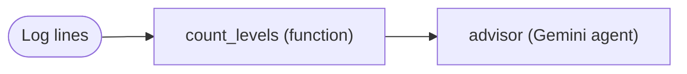

# Quickstart

The smallest useful `adk-kanode` workflow: one function node and one Gemini
agent, each running in its own Kubernetes worker. There are no per-node
options beyond passing the Gemini settings to the agent's worker.



```python
# A function node: add @kanode.
@kanode
def count_levels(node_input: str) -> Event: ...

# An agent node: wrap the agent with kanode().
advisor = kanode(
    Agent(name="advisor", model="gemini-2.5-flash", instruction="..."),
    env=_GENAI_ENV,
)

root_agent = Workflow(
    name="quickstart_workflow",
    edges=[("START", count_levels, advisor)],
)

app = App(name="quickstart", root_agent=root_agent, plugins=[K8sPlugin()])
```

The whole example is [`agent.py`](agent.py). `count_levels` counts log lines by
level and reports the pod it ran in; `advisor` reads that summary and says what
to check first.

## Run it locally

No cluster or Gemini needed. The test runs `count_levels` in a local subprocess
and replaces the agent with a stub:

```bash
uv run pytest tests/test_quickstart_example.py
```

## Deploy to GKE

You need a GKE cluster and Vertex AI access for `adk-worker-sa` through
Workload Identity. Run from the repository root:

```bash
export ADK_K8S_IMAGE="us-docker.pkg.dev/<PROJECT_ID>/<REPO>/adk-kanode-quickstart:latest"
export ADK_K8S_NAMESPACE="default"
export GOOGLE_CLOUD_PROJECT="<PROJECT_ID>"
export GOOGLE_CLOUD_LOCATION="<LOCATION>"

docker build --network=host -f examples/Dockerfile -t "$ADK_K8S_IMAGE" .
docker push "$ADK_K8S_IMAGE"
envsubst < examples/k8s.yaml | kubectl apply -f -
```

[`../k8s.yaml`](../k8s.yaml) creates the ServiceAccounts, the RBAC role, and an
`adk web` Deployment behind a `LoadBalancer` Service.

Open the `adk-web-example-svc` address, pick the `quickstart` app, and send a
few log lines:

```text
INFO service started
WARN slow request 950ms
ERROR database timeout
```

The first reply shows the counts and the pod that counted them; the second is
the agent's advice. Watch the two workers with:

```bash
kubectl get pods -n "$ADK_K8S_NAMESPACE" -l app.kubernetes.io/managed-by=adk-kanode
```

The first message creates one warm Deployment per node, so it takes longer than
the following ones.

## Next

- [`../gke-sandbox/`](../gke-sandbox/) runs one node of a workflow inside GKE Sandbox.
- [`../swarm/`](../swarm/) starts a different set of agents for each request.
