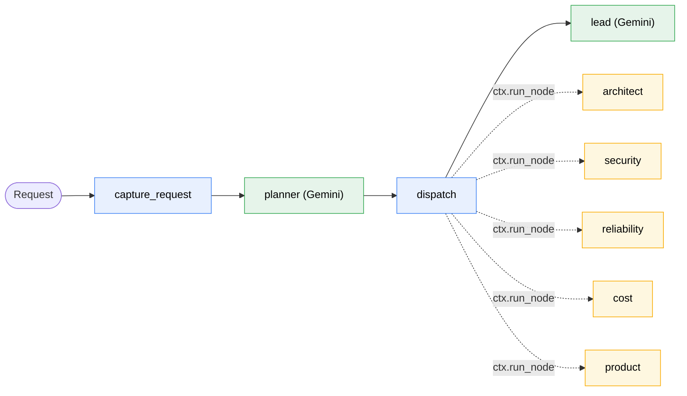

# Dynamic agent swarm

A review board of specialist agents. A planner reads the request and decides,
per request, which specialists are needed and what each one should work out.
Every chosen specialist then does its part in parallel, in its own Kubernetes
worker, and a lead agent turns their reports into one recommendation.



Solid arrows are the workflow graph, which is fixed. Dotted arrows are decided
at runtime: a request about a login change may only reach `security` and
`product`, while a migration plan may reach all five.

## How the dynamic part works

The specialists are not in the graph. Each one is a `@kanode` agent kept in a
dictionary:

```python
SPECIALISTS = {
    name: kanode(Agent(name=name, model=MODEL, instruction=...), env=_GENAI_ENV)
    for name, part in ROSTER.items()
}
```

The planner returns a typed plan (`Plan`, a list of `specialist` + `task`), and
`dispatch` starts one specialist per assignment with ADK's `ctx.run_node`:

```python
@node(rerun_on_resume=True)  # required for any node that calls ctx.run_node()
async def dispatch(ctx: Context, node_input: dict[str, Any], request: str = "") -> Event:
    plan = Plan.model_validate(node_input)
    assignments = [a for a in plan.assignments if a.specialist in SPECIALISTS]

    reports = await asyncio.gather(
        *(
            ctx.run_node(
                SPECIALISTS[a.specialist],
                f"Request:\n{request}\n\nYour assignment:\n{a.task}",
                use_sub_branch=True,
            )
            for a in assignments
        )
    )
```

`adk-kanode` adds nothing special here. A `@kanode` node is a regular ADK node,
so `ctx.run_node` on it runs the call in that node's worker.

| Node | Runs in | Why |
| --- | --- | --- |
| `capture_request`, `dispatch` | the workflow host | `dispatch` needs the workflow context to start other nodes |
| `planner`, `lead` | one warm worker each | regular `@kanode` agents in the graph |
| each specialist | its own warm worker | started on demand by `dispatch` |

To change the swarm, edit `ROSTER` in [`agent.py`](agent.py). A new entry
becomes a new agent, a new worker, and a new option for the planner.

## Run the graph locally

[`tests/test_swarm_example.py`](../../tests/test_swarm_example.py) runs the
real `dispatch` node without a cluster or Gemini. The planner, the lead and the
specialists are replaced by stubs, and the specialists run in local subprocesses.

```bash
uv run pytest tests/test_swarm_example.py
```

## Deploy to GKE

You need a GKE cluster and Vertex AI access for `adk-worker-sa` through
Workload Identity. Run from the repository root:

```bash
export ADK_K8S_IMAGE="us-docker.pkg.dev/<PROJECT_ID>/<REPO>/adk-kanode-swarm:latest"
export ADK_K8S_NAMESPACE="default"
export GOOGLE_CLOUD_PROJECT="<PROJECT_ID>"
export GOOGLE_CLOUD_LOCATION="<LOCATION>"

docker build --network=host -f examples/Dockerfile \
  --build-arg AGENT_SRC=examples/swarm \
  --build-arg AGENT_NAME=swarm \
  -t "$ADK_K8S_IMAGE" .
docker push "$ADK_K8S_IMAGE"

envsubst < examples/k8s.yaml | kubectl apply -f -
```

Open the `adk-web-example-svc` address and pick the `swarm` app. Try requests
that need different specialists:

| Request | Likely swarm |
| --- | --- |
| `Replace password login with passkeys for all users` | security, product |
| `Move our Postgres from a VM to a managed service` | architect, reliability, cost |
| `Launch a public API for our internal pricing service` | most of the roster |

The `dispatch` message lists who was picked. The seven workers (planner, lead
and five specialists) show up as Deployments:

```bash
kubectl get deployments -n "$ADK_K8S_NAMESPACE" -l app.kubernetes.io/managed-by=adk-kanode
```

## Things to know

- **The plan is model output.** `dispatch` drops specialists that are not in
  the roster and runs at most `MAX_ASSIGNMENTS` of them.
- **A specialist can get several assignments.** They run concurrently on that
  specialist's worker. Set `replicas=` on a specialist to spread them out.
- **All specialists are prewarmed.** `agent.py` starts every worker at load
  time, so an unused specialist still holds a pod. Remove the prewarm loop to
  start a specialist only when it is first picked.
- **Specialists have no tools.** They only see the request and their assignment.
