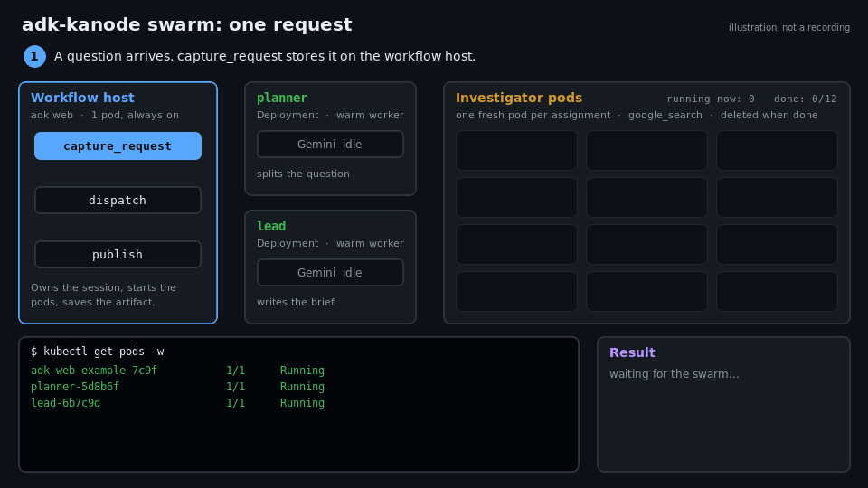
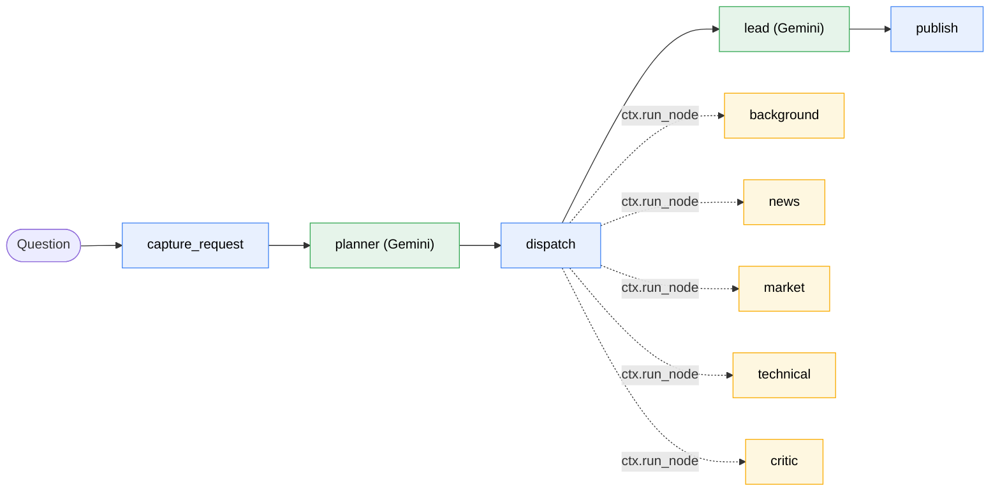

# Dynamic agent swarm

A research team of investigator agents that search Google. A planner reads the
question and decides, per request, which investigators are needed and what each
one should find out. Every chosen investigator then searches in parallel, in
its own Kubernetes worker, and a lead agent turns their findings into one
brief. The brief, every finding with its sources, and the timings are saved as
a Markdown artifact.



*An illustration of one request with one pod per assignment, not a recording.
The numbers are made up.*



Solid arrows are the workflow graph, which is fixed. Dotted arrows are decided
at runtime: a question about last week's announcement may only reach `news`,
while a question about whether to adopt a product may reach all five.

## What happens on one request

Take the question `Should a small team adopt gVisor for running untrusted code?`

| Step | Node | Where it runs | What it does |
| --- | --- | --- | --- |
| 1 | `capture_request` | workflow host | Stores the question in session state. |
| 2 | `planner` | its own worker | Gemini reads the question and the roster and returns a typed plan, for example `background`: "what gVisor is and who maintains it", `technical`: "performance overhead of gVisor compared to runc", `critic`: "known gVisor escapes and limitations". |
| 3 | `dispatch` | workflow host | Drops assignments for unknown investigators, caps the list, and starts one investigator per assignment with `ctx.run_node`, all at the same time. |
| 4 | investigators | one worker each | Each one searches Google for its assignment only and returns up to five findings. The pages it used come back with them. |
| 5 | `dispatch` | workflow host | Collects the findings, the sources and how long each run took, and reports the swarm: `Swarm of 3: background, technical, critic`. |
| 6 | `lead` | its own worker | Gemini writes one brief from the findings: an answer, the findings behind it, and what is still unknown. It has no tools and sees only the findings. |
| 7 | `publish` | workflow host | Saves the brief, the findings, the sources and the timings as `swarm-report.md`. |

Three things make this a swarm and not a pipeline:

- **The team is picked per request.** The graph never changes, but which
  investigators run, how many, and what each one is asked is decided by the
  planner for every question.
- **The investigators run side by side.** Three investigators that each take
  ten seconds finish in about ten seconds, not thirty, because each has its own
  worker.
- **Each agent is isolated.** An investigator sees the question and its own
  assignment, nothing from the others. Only `dispatch` and `lead` see the
  combined findings.

The saved report looks like this (shortened, with made-up numbers):

```markdown
# Investigation report

**Question:** Should a small team adopt gVisor for running untrusted code?

## Brief

Yes, if the workload can accept slower system calls. ...

## Swarm

3 assignments ran in parallel: 31.4s of investigation finished in 11.8s (2.7x faster than one after another).

| # | Investigator | Assignment | Sources | Seconds |
| --- | --- | --- | --- | --- |
| 1 | background | what gVisor is and who maintains it | 4 | 9.6 |
| 2 | technical | performance overhead of gVisor compared to runc | 6 | 11.8 |
| 3 | critic | known gVisor escapes and limitations | 5 | 10.0 |

## Findings

### 1. background

Assignment: what gVisor is and who maintains it

- ...

Sources:

- [gvisor.dev](https://vertexaisearch.cloud.google.com/grounding-api-redirect/...)
```

## How the dynamic part works

The investigators are not in the graph. Each one is a `@kanode` agent with
ADK's `google_search` tool, kept in a dictionary:

```python
INVESTIGATORS = {
    name: kanode(
        Agent(name=name, model=MODEL, tools=[google_search], instruction=...),
        env=_GENAI_ENV,
    )
    for name, angle in ROSTER.items()
}
```

The planner returns a typed plan (`Plan`, a list of `investigator` + `task`),
and `dispatch` starts one investigator per assignment with ADK's `ctx.run_node`:

```python
@node(rerun_on_resume=True)  # required for any node that calls ctx.run_node()
async def dispatch(ctx: Context, node_input: dict[str, Any], request: str = "") -> Event:
    plan = Plan.model_validate(node_input)
    assignments = [a for a in plan.assignments if a.investigator in INVESTIGATORS]

    async def run(assignment: Assignment) -> dict[str, Any]:
        findings = await ctx.run_node(
            INVESTIGATORS[assignment.investigator],
            f"Question:\n{request}\n\nYour assignment:\n{assignment.task}",
            use_sub_branch=True,
        )
        ...

    runs = await asyncio.gather(*(run(a) for a in assignments))
```

`adk-kanode` adds nothing special here. A `@kanode` node is a regular ADK node,
so `ctx.run_node` on it runs the call in that node's worker.

| Node | Runs in | Why |
| --- | --- | --- |
| `capture_request`, `dispatch`, `publish` | the workflow host | `dispatch` needs the workflow context to start other nodes, `publish` to save the artifact |
| `planner`, `lead` | one warm worker each | regular `@kanode` agents in the graph |
| each investigator | its own warm worker | started on demand by `dispatch` |

To change the swarm, edit `ROSTER` in [`agent.py`](agent.py). A new entry
becomes a new agent, a new worker, and a new option for the planner.

## Searching Google

`google_search` is a tool that Gemini runs itself: the model searches while it
writes its answer, and returns the pages it used with the response. So the
investigator workers need no search API key and no extra network access beyond
Vertex AI.

The tool reaches the worker because `@kanode` records where each of an agent's
tools can be imported from, and the worker imports them again. That works for
module-level tool objects such as `google_search` and for module-level
functions. A tool the worker cannot import is rejected when the agent is
wrapped.

`dispatch` reads the pages each investigator was given from that investigator's
event and keeps them with its findings, so the report can list them.

## Run the graph locally

[`tests/test_swarm_example.py`](../../tests/test_swarm_example.py) runs the
real `dispatch` and `publish` nodes without a cluster or Gemini. The planner,
the lead and the investigators are replaced by stubs.

```bash
uv run pytest tests/test_swarm_example.py
```

## Deploy to GKE

You need a GKE cluster and Vertex AI access for `adk-worker-sa` through
Workload Identity. Run from the repository root:

```bash
export ADK_K8S_IMAGE="us-docker.pkg.dev/<PROJECT_ID>/<REPO>/adk-kanode-swarm:latest"
export ADK_K8S_NAMESPACE="default"
export GOOGLE_CLOUD_PROJECT="<PROJECT_ID>"
export GOOGLE_CLOUD_LOCATION="<LOCATION>"

docker build --network=host -f examples/Dockerfile \
  --build-arg AGENT_SRC=examples/swarm \
  --build-arg AGENT_NAME=swarm \
  -t "$ADK_K8S_IMAGE" .
docker push "$ADK_K8S_IMAGE"

envsubst < examples/k8s.yaml | kubectl apply -f -

kubectl rollout status deployment/adk-web-example -n "$ADK_K8S_NAMESPACE"
kubectl port-forward svc/adk-web-example-svc 8080:80 -n "$ADK_K8S_NAMESPACE"
```

Open http://localhost:8080 and pick the `swarm` app. Try questions that need
different investigators:

| Question | Likely swarm |
| --- | --- |
| `What did Kubernetes change in its latest release?` | news, technical |
| `Who are the main managed Postgres providers and what do they charge?` | market, background |
| `Should a small team adopt gVisor for running untrusted code?` | most of the roster |

The `dispatch` message lists who was picked. The seven workers (planner, lead
and five investigators) show up as Deployments:

```bash
kubectl get deployments -n "$ADK_K8S_NAMESPACE" -l app.kubernetes.io/managed-by=adk-kanode
```

## The report artifact

`dispatch` times every investigator run, and `publish` saves one file per
request, `swarm-report.md`, through ADK's artifact service. Open it from the
Artifacts tab in `adk web`. It holds:

- the question and the lead's brief,
- a table of the assignments with the number of sources and the seconds each
  one took,
- how long the investigators worked in total and how long the swarm took, for
  example `12 assignments ran in parallel: 96.4s of investigation finished in 11.2s`,
- every investigator's findings, followed by links to the pages Google Search
  gave it.

`adk web` keeps artifacts in memory by default, so they are lost when the host
restarts. Start it with `--artifact_service_uri=gs://<BUCKET>` to keep them in
Cloud Storage.

## Scale it up

By default a request starts at most 6 investigator runs, on one warm worker per
investigator. Settings on the workflow host change that:

| Variable | Default | Effect |
| --- | --- | --- |
| `SWARM_MAX_ASSIGNMENTS` | `6` | The most investigator runs one request may start |
| `SWARM_INVESTIGATOR_MODE` | `deployment` | `pod` runs every assignment in its own fresh pod |
| `ADK_K8S_REPLICAS` | `1` | Warm replicas per worker, in deployment mode |

**One pod per assignment.** This is the easiest way to see the fan-out:

```bash
kubectl set env deployment/adk-web-example -n "$ADK_K8S_NAMESPACE" \
  SWARM_MAX_ASSIGNMENTS=30 SWARM_INVESTIGATOR_MODE=pod

kubectl get pods -n "$ADK_K8S_NAMESPACE" -w
```

Then send a question with many separate items, so the planner writes one
assignment per item:

```text
Compare these 10 vector databases: Pinecone, Weaviate, Milvus, Qdrant, Chroma,
pgvector, Vespa, LanceDB, Redis and Elasticsearch. Give the market investigator
one assignment per database and the technical investigator one assignment per
database.
```

About twenty pods start together and are deleted as they finish. The
`dispatch` message and the artifact show the total investigation time next to
the time the swarm took.

**Warm replicas.** For steady traffic keep `SWARM_INVESTIGATOR_MODE` unset and
raise the replica count instead. Calls are spread over the replicas of each
worker:

```bash
kubectl set env deployment/adk-web-example -n "$ADK_K8S_NAMESPACE" \
  SWARM_MAX_ASSIGNMENTS=30 SWARM_INVESTIGATOR_MODE- ADK_K8S_REPLICAS=3
```

`kubectl set env` restarts the host, so start the port-forward again afterwards.
The cluster needs room for the pods: each one requests 250m CPU and 256Mi of
memory with the settings in [`../k8s.yaml`](../k8s.yaml).

## Things to know

- **The plan is model output.** `dispatch` drops investigators that are not in
  the roster and runs at most `MAX_ASSIGNMENTS` of them. The planner decides
  how many assignments to write, so the size of the swarm varies between runs.
- **Findings are web content.** What an investigator reports comes from pages
  on the internet. The lead is told to use only the findings, and it has no
  tools, so the worst a misleading page can do is produce a wrong brief. Do not
  let the brief drive privileged actions.
- **Source links are Google redirect links.** On Vertex AI each source is a
  `vertexaisearch.cloud.google.com` link titled with the site's domain, and the
  links expire. An investigator that answered without searching has no sources.
- **Search has its own quota and price.** Every investigator run is a Gemini
  call with Grounding with Google Search, which is billed and rate-limited
  separately from plain Gemini calls. A swarm of thirty makes thirty of them at
  once.
- **An investigator can get several assignments.** They run concurrently on
  that investigator's worker. Set `replicas=` on an investigator to spread them
  out.
- **All investigators are prewarmed.** `agent.py` starts every worker at load
  time, so an unused investigator still holds a pod. Remove the prewarm loop to
  start an investigator only when it is first picked.
